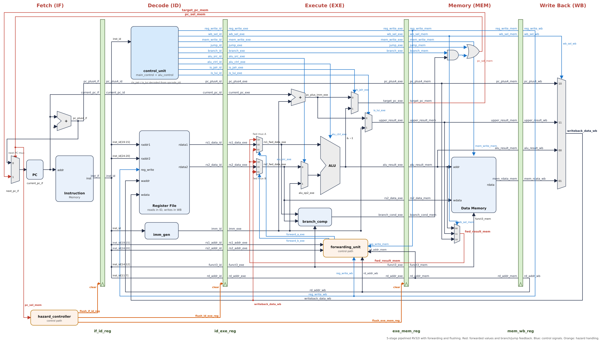

# RV32I 5-Stage Pipelined Processor

A 5-stage pipelined RISC-V (RV32I) processor in SystemVerilog, with hardware
hazard handling:

- **Forwarding** from the MEM and WB stages into EXE resolves data hazards.
- **Flushing**: a hazard controller clears the three pipeline registers behind
  a taken branch or a jump, which resolves control hazards.

The only hazard left to software is the load-use hazard (one `nop` after a
load whose result is used by the next instruction).



## Features

- Stages: IF, ID, EXE, MEM, WB, with every signal named after its stage
  (`_if`, `_id`, `_exe`, `_mem`, `_wb`)
- 37 RV32I instructions: all R-type, I-type, loads (byte, half, word,
  signed and unsigned), stores, branches, `jal`, `jalr`, `lui`, `auipc`
- Branches and jumps resolved in the MEM stage
- Write-through register file (WB and ID can share a cycle)
- `FORWARDING_EN` and `FLUSH_EN` parameters on `rv32i_top` to switch the
  hazard hardware off, used to compare against a pipeline without it

## Results

`tb/benchmark_tb.sv` runs the same program on two configurations:

| Configuration | Program | Instructions | Cycles |
|---|---|---|---|
| No hazard hardware, hazards resolved with `nop`s | `benchmark_nops.s` | 105 (49 `nop`s) | 118 |
| Forwarding + flushing | `benchmark.s` | 56 | 87 |

That is **26% fewer cycles** and a 47% smaller program, with identical results.

## Hazard handling

### Forwarding

Two multiplexers in the EXE stage, in front of the ALU, the branch comparator
and the store data path, select each source operand:

| `forward_a_exe` / `forward_b_exe` | Operand |
|---|---|
| `00` | register file (read in ID) |
| `10` | result of the instruction in MEM (`fwd_result_mem`) |
| `01` | result of the instruction in WB (`writeback_data_wb`) |

The forwarding unit (`rtl/forwarding_unit.sv`) compares `rs1`/`rs2` of the
instruction in EXE with `rd` of the instructions in MEM and WB. The MEM stage
has priority, so the newest value wins when both write the same register;
`x0` is never forwarded. `fwd_result_mem` is the ALU result, PC+4 (JAL/JALR)
or the LUI/AUIPC result, selected by `wb_sel_mem`. Load data is not forwarded
from MEM, which is why the load-use hazard still needs a `nop`.

### Flushing

When a taken branch or a jump is in MEM (`pc_sel_mem = 1`), the instructions
in EXE, ID and IF are on the wrong path. The hazard controller
(`rtl/hazard_controller.sv`) asserts `flush_exe_mem_reg`, `flush_id_exe_reg`
and `flush_if_id_reg`. These are synchronous clears on the pipeline registers,
so on the same clock edge on which the PC loads the target, those
instructions become bubbles. `mem_wb_reg` is never cleared, because the branch
or jump itself must complete (JAL/JALR write their link register). A branch
that is not taken costs nothing.

## Repository layout

```
rtl/             processor RTL (files.f lists the compile order)
tb/              unit and system testbenches
programs/        test programs: assembly (.s) and assembled (.hex)
docs/            micro-architecture diagram
tools/           asm2hex.py (assembler wrapper), iss.py (reference model)
machine.hex      main test program (programs/hazard_test.hex)
run_tests.sh     runs all testbenches with Icarus Verilog
create_project.tcl, add_waves.tcl   Vivado project and waveform setup
```

## Testbenches

| Testbench | What it checks |
|---|---|
| `rv32i_top_tb` | Main test (`hazard_test.s`): no `nop`s for data or control hazards. Wrong-path instructions sit behind every taken branch and jump. Checks all registers and 19 memory words, and reports forwarding and flush counts. |
| `forwarding_test_tb` | `forwarding_test.s` with flushing off: every forwarding path (EX and MEM hazards, double hazard, store data and address, branch operands, JALR base, LUI/AUIPC, x0, loads). |
| `data_hazard_demo_tb` | A short sequence on three processors at once: no handling (two instructions read stale values), `nop`s, and forwarding. |
| `control_hazard_demo_tb` | A short sequence on three processors at once: no handling (a wrong-path instruction executes), `nop`s, and flushing. |
| `benchmark_tb` | Cycle count with and without the hazard hardware (see Results). |
| others | Unit tests: ALU, ALU control, main control, control unit, immediate generator, branch comparator, register file, data and instruction memory, program counter, pipeline register, forwarding unit, hazard controller, data path. |

Expected values were generated with `tools/iss.py`, a small instruction-level
RV32I simulator that runs a `.hex` program and prints the final registers and
memory.

## Running

With Icarus Verilog (11 or newer):

```sh
./run_tests.sh
```

This runs every testbench in `build/` and prints PASS/FAIL for each.

In Vivado (tested with 2022.2), from the Tcl console:

```
source /path/to/rv32i-pipelined/create_project.tcl
```

Then run **Run Simulation > Run Behavioral Simulation**; `rv32i_top_tb` is the
default top. To run another testbench, right-click it under
**Simulation Sources > sim_1** and choose **Set as Top**. After the simulation
opens, `source add_waves.tcl` adds the stage, forwarding and flush signals to
the waveform. The script copies the `.hex` programs into the simulator's run
directory; if a simulation reports a program was not loaded, copy
`machine.hex` and `programs/*.hex` there again.

To change a program, edit the `.s` file and reassemble it (needs the RISC-V
GNU binutils, `riscv64-unknown-elf-as`):

```sh
python3 tools/asm2hex.py programs/hazard_test.s programs/hazard_test.hex
```

## Limitations

- The load-use hazard is handled in software; there is no stall logic.
- Branches resolve in MEM, so a taken branch costs 3 cycles.
- No CSRs, `ecall`/`ebreak`/`fence`, traps or interrupts.
